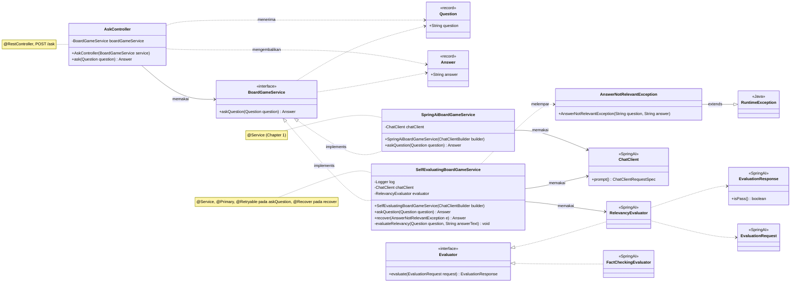
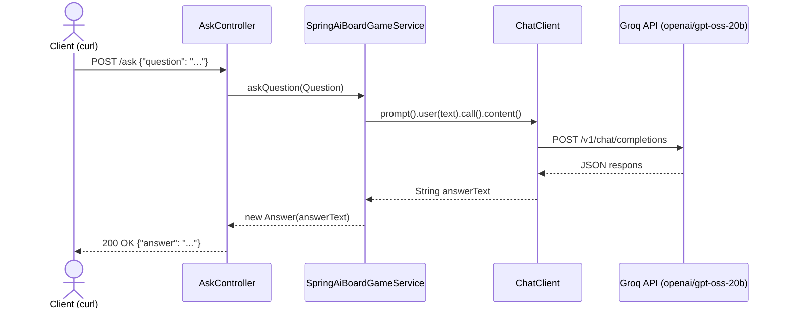
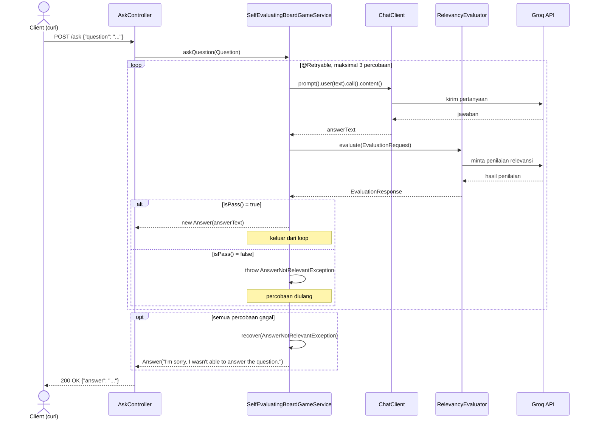

# Board Game Buddy: Spring AI in Action (Chapter 1 & 2)

Proyek ini adalah implementasi **Chapter 1 (Getting Started with Spring AI)** dan **Chapter 2 (Evaluating Generated Responses)** dari buku *Spring AI in Action* karya Craig Walls. Dibuat sebagai tugas UAS mata kuliah ADSE.

| | |
|---|---|
| **Nama** | `Danish Shafa Aliya` |
| **NIM** | `12409011050103` |
| **Mata kuliah** | ADSE |
| **Dosen** | Rizal Broer (rizalbroer@uinjkt.ac.id) |
| **Jawaban Pengerjaan** | `https://drive.google.com/drive/folders/1QjqasCvVZvgHovgRyro2pRfcwU7g9UG4?usp=drive_link` |

---

## 1. Deskripsi singkat

Board Game Buddy adalah layanan REST sederhana yang menerima pertanyaan dalam bentuk JSON, mengirimkannya ke Large Language Model (LLM) lewat **Spring AI**, lalu mengembalikan jawabannya.

- **Chapter 1**: membuat REST API tanya-jawab dengan `ChatClient`, serta unit test dengan **WireMock** agar hasil test deterministik.
- **Chapter 2**: menambahkan **evaluator** (`RelevancyEvaluator` dan `FactCheckingEvaluator`) untuk menguji kualitas jawaban LLM, serta **self-evaluation saat runtime** dengan **Spring Retry** (`@Retryable` dan `@Recover`).

## 2. Teknologi yang dipakai

| Komponen | Versi / Keterangan |
|---|---|
| Java | 21 (JDK 21.0.x) |
| Spring Boot | 3.5.5 |
| Spring AI | 1.0.1 (dikelola lewat BOM `spring-ai-bom`) |
| Build tool | Gradle (Groovy DSL) |
| Provider LLM | Groq (endpoint kompatibel OpenAI), model `openai/gpt-oss-20b` |
| Starter | `spring-ai-starter-model-openai` |
| Testing | JUnit 5, AssertJ, WireMock (`wiremock-spring-boot` 3.9.0) |
| Retry | `spring-retry` + `spring-boot-starter-aop` |
| IDE | IntelliJ IDEA |

> **Catatan:** Spring Initializr saat ini hanya menawarkan Spring Boot 4.x, sedangkan Spring AI 1.0.1 dirancang untuk Spring Boot 3.5.x. Karena itu proyek dibuat dari Initializr lalu `build.gradle` disesuaikan manual ke Boot 3.5.5 agar kode sama dengan buku.

## 3. Struktur proyek

```
boardgamebuddy
├── build.gradle
├── src
│   ├── main
│   │   ├── java/com/example/boardgamebuddy
│   │   │   ├── BoardgamebuddyApplication.java      # entry point, @EnableRetry
│   │   │   ├── AskController.java                  # POST /ask
│   │   │   ├── BoardGameService.java               # interface
│   │   │   ├── SpringAiBoardGameService.java       # implementasi Chapter 1
│   │   │   ├── SelfEvaluatingBoardGameService.java # implementasi Chapter 2 (@Primary)
│   │   │   ├── AnswerNotRelevantException.java
│   │   │   ├── Question.java                       # record
│   │   │   └── Answer.java                         # record
│   │   └── resources/application.properties
│   └── test
│       ├── java/com/example/boardgamebuddy
│       │   ├── SpringAiBoardGameServiceWireMockTests.java  # Chapter 1
│       │   └── SpringAiBoardGameServiceTests.java          # Chapter 2 (evaluator)
│       └── resources/test-openai-response.json
└── docs/diagrams/                                   # gambar diagram UML
```

## 4. Prasyarat

1. **JDK 21** (cek dengan `java -version`).
2. **Git**.
3. **IntelliJ IDEA** (atau IDE lain yang mendukung Gradle).
4. **API key Groq** (gratis) dari <https://console.groq.com> → *API Keys* → *Create API Key*.

## 5. Konfigurasi

### 5.1 `application.properties`

```properties
spring.ai.openai.base-url=https://api.groq.com/openai
spring.ai.openai.chat.options.model=openai/gpt-oss-20b
spring.http.client.connect-timeout=10s
spring.http.client.read-timeout=30s
```

Spring AI menyediakan starter OpenAI yang dapat dipakai untuk provider mana pun yang kompatibel dengan API OpenAI. Mengganti provider hanya mengubah `base-url`, nama model, dan API key, **bukan kode**.

### 5.2 API key (jangan ditulis di kode!)

API key dibaca dari environment variable `SPRING_AI_OPENAI_API_KEY` (Spring Boot memetakannya ke `spring.ai.openai.api-key`). Dengan cara ini key tidak ikut ter-commit ke GitHub.

**IntelliJ:** *Run → Edit Configurations → BoardgamebuddyApplication → Modify options → Environment variables*, lalu isi:

```
SPRING_AI_OPENAI_API_KEY=gsk_xxxxxxxxxxxxxxxx
```

**PowerShell (untuk menjalankan test dari terminal):**

```powershell
$env:SPRING_AI_OPENAI_API_KEY="gsk_xxxxxxxxxxxxxxxx"
```

**CMD:**

```cmd
set SPRING_AI_OPENAI_API_KEY=gsk_xxxxxxxxxxxxxxxx
```

## 6. Cara menjalankan

```bash
git clone https://github.com/<USERNAME>/<NAMA-REPO>.git
cd <NAMA-REPO>
```

Jalankan aplikasi dari IntelliJ (tombol ▶ di `BoardgamebuddyApplication`) atau lewat terminal:

```powershell
.\gradlew.bat bootRun        # Windows PowerShell
./gradlew bootRun            # Mac / Linux
```

Aplikasi berjalan di `http://localhost:8080`.

### Mencoba endpoint `POST /ask`

CMD Windows:

```cmd
curl.exe -m 60 localhost:8080/ask -H "Content-type: application/json" -d "{\"question\":\"Why is the sky blue?\"}"
```

PowerShell:

```powershell
curl.exe -m 60 localhost:8080/ask -H "Content-type: application/json" -d '{"question":"Why is the sky blue?"}'
```

Mac / Linux:

```bash
curl localhost:8080/ask -H "Content-type: application/json" -d '{"question":"Why is the sky blue?"}'
```

Contoh respons:

```json
{"answer":"The sky looks blue because of Rayleigh scattering ..."}
```

Pertanyaan yang sama akan menghasilkan jawaban yang **berbeda-beda** karena LLM bersifat non-deterministik.

## 7. Menjalankan test

```powershell
# Test WireMock (Chapter 1), tidak butuh API key asli
.\gradlew.bat test --tests "*WireMockTests"

# Test evaluator (Chapter 2), butuh API key asli karena memanggil LLM
$env:SPRING_AI_OPENAI_API_KEY="gsk_xxxxxxxxxxxxxxxx"
.\gradlew.bat test --tests "*SpringAiBoardGameServiceTests"

# Semua test
.\gradlew.bat test
```

Laporan test tersedia di `build/reports/tests/test/index.html`.

| Test | Chapter | Tujuan |
|---|---|---|
| `SpringAiBoardGameServiceWireMockTests.testAskQuestion` | 1 | Memastikan `askQuestion()` memproses respons LLM dengan benar. LLM diganti WireMock yang mengembalikan `"Paris"`. |
| `SpringAiBoardGameServiceTests.evaluateRelevancy` | 2 | Memakai `RelevancyEvaluator` untuk menilai apakah jawaban relevan dengan pertanyaan. |
| `SpringAiBoardGameServiceTests.evaluateFactualAccuracy` | 2 | Memakai `FactCheckingEvaluator` untuk menilai kebenaran jawaban. |

---

## 8. Diagram UML

### 8.1 Class diagram (Chapter 1 dan 2)



### 8.2 Sequence diagram Chapter 1



### 8.3 Sequence diagram Chapter 2 (self-evaluation, retry, recover)



---

## 9. Penjelasan kode

| Elemen | Penjelasan |
|---|---|
| `Question`, `Answer` | Java *record* (immutable) sebagai pembawa data permintaan dan respons. |
| `BoardGameService` | Interface dengan satu method `askQuestion(Question): Answer`. Controller hanya bergantung pada interface ini (*programming to an interface*). |
| `SpringAiBoardGameService` | Implementasi Chapter 1. Memakai `ChatClient` dengan *fluent API* `prompt().user(...).call().content()` untuk mengirim prompt dan mengambil teks jawaban. |
| `SelfEvaluatingBoardGameService` | Implementasi Chapter 2, ditandai `@Primary` agar dipilih Spring. Setelah mendapat jawaban, jawaban dinilai oleh `RelevancyEvaluator`. Jika tidak relevan, dilempar `AnswerNotRelevantException` sehingga `@Retryable` mengulang (default 3 kali). Jika semua gagal, `@Recover` mengembalikan jawaban permintaan maaf. |
| `AskController` | `@RestController` dengan `@PostMapping("/ask")`. Mengikat body JSON ke `Question` dan mengembalikan `Answer`. |
| `AnswerNotRelevantException` | `RuntimeException` khusus yang menandakan jawaban tidak relevan, dipakai sebagai pemicu retry. |
| `RelevancyEvaluator` / `FactCheckingEvaluator` | Evaluator bawaan Spring AI. Keduanya mengirim pertanyaan dan jawaban ke LLM sebagai "juri" (*LLM-as-a-judge*) dan mengembalikan `EvaluationResponse.isPass()`. Keduanya berbasis interface `Evaluator`, sehingga evaluator kustom dapat dibuat sendiri. |
| `@EnableRetry` | Mengaktifkan dukungan Spring Retry pada aplikasi. |

## 10. Perbedaan dengan buku dan alasannya

| Di buku | Di proyek ini | Alasan |
|---|---|---|
| Java 24, Spring Boot 3.5.5 dari Initializr | Java 21, Boot 3.5.5 diatur manual di `build.gradle` | JDK yang terpasang 21, dan Initializr hanya menawarkan Boot 4.x. |
| Provider OpenAI, model `gpt-4o-mini` | Groq, model `openai/gpt-oss-20b` | Memakai layanan gratis. Starter OpenAI kompatibel sehingga kode tidak berubah. |
| `ChatOptions` memilih model `gpt-4o-mini` di `SelfEvaluatingBoardGameService` | Dihapus, model dibaca dari `application.properties` | Model `gpt-4o-mini` tidak tersedia di Groq. |
| Tidak ada `@Primary` | `@Primary` pada `SelfEvaluatingBoardGameService` | Dua bean mengimplementasi `BoardGameService`, tanpa `@Primary` terjadi `NoUniqueBeanDefinitionException`. |
| Dependency Spring Retry tidak dituliskan | Ditambah `spring-retry`, `spring-boot-starter-aop`, dan `@EnableRetry` | Diperlukan agar `@Retryable` dan `@Recover` berfungsi. |
| Tanpa logging | Ditambah log hasil evaluasi | Agar proses evaluasi dan retry terlihat saat demo. |

## 11. Troubleshooting yang dialami

| Gejala | Penyebab | Solusi |
|---|---|---|
| `HTTP 404 ... model no longer available` (Gemini) | Nama model sudah dicabut untuk akun baru | Ganti nama model di `application.properties`. |
| `HTTP 503 ... high demand` | Server penyedia sedang penuh | Tunggu, atau pindah ke model atau provider lain. |
| `HTTP 400 ... Unhandled generated data mime type: audio/wav` | Model yang dipilih adalah model audio, bukan teks | Pilih model teks dari daftar model penyedia. |
| `curl` menggantung lalu `timed out` | Tidak ada batas waktu tunggu bawaan | Tambahkan `spring.http.client.read-timeout`. |
| `HTTP 404 model_not_found` (Groq) | Nama model tidak ada di akun | Cek daftar lewat `https://api.groq.com/openai/v1/models`. |
| `gradlew.bat is not recognized` di PowerShell | PowerShell tidak menjalankan file dari folder saat ini | Gunakan `.\gradlew.bat`. |
| `set KEY=...` tidak berpengaruh di PowerShell | `set` adalah alias `Set-Variable` | Gunakan `$env:KEY="..."`. |
| `Could not resolve host` pada `curl` | Kutip tunggal tidak dikenali CMD | Di CMD pakai kutip ganda dengan escape `\"`. |

## 12. Versioning

Repo memakai tag untuk menandai tiap tahap tugas:

| Tag | Isi |
|---|---|
| `v1.0-chapter1` | Chapter 1: REST API Spring AI dan test WireMock |
| `v2.0-chapter2` | Chapter 2: evaluator, self-evaluation, retry |

```bash
git checkout v1.0-chapter1   # melihat kode Chapter 1
git checkout main            # kembali ke versi terbaru
```

## 13. Teori singkat

**Manfaat dan kelebihan Spring AI**
- Abstraksi klien yang konsisten untuk banyak provider (OpenAI, Anthropic, Azure OpenAI, Google, Mistral, Ollama, dan lainnya), sehingga kode portabel.
- Auto-configuration dan starter Spring Boot, jadi Java developer memakai model pemrograman yang sudah dikenal.
- Dukungan fitur lanjutan: prompt template, chat memory, RAG, tools/MCP, multimodal, dan evaluator.

**Kekurangan dan tantangan**
- LLM bersifat **non-deterministik**, jawaban berbeda tiap permintaan, sehingga tidak bisa diuji dengan `assertEquals` biasa.
- Ketergantungan pada layanan eksternal (ketersediaan, perubahan nama model, rate limit).
- Biaya berbasis token, dan setiap retry atau evaluasi menambah panggilan ke LLM.
- Evaluator yang berbasis LLM sendiri tidak 100% pasti.

## 14. Referensi

- Craig Walls, *Spring AI in Action*, Manning.
- Dokumentasi Spring AI: <https://docs.spring.io/spring-ai/reference/>
- Spring Initializr: <https://start.spring.io>
- Groq Console: <https://console.groq.com>
- WireMock: <https://wiremock.org>
